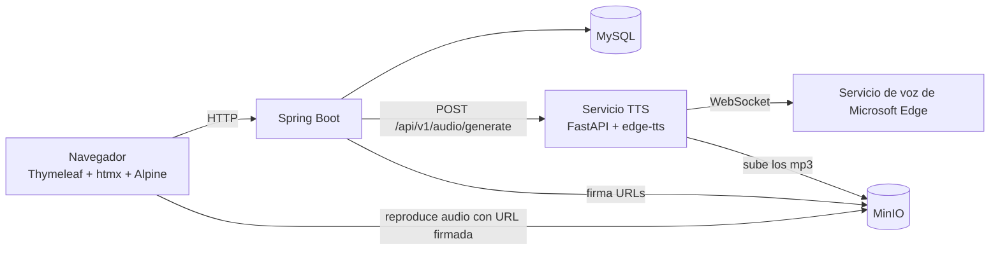
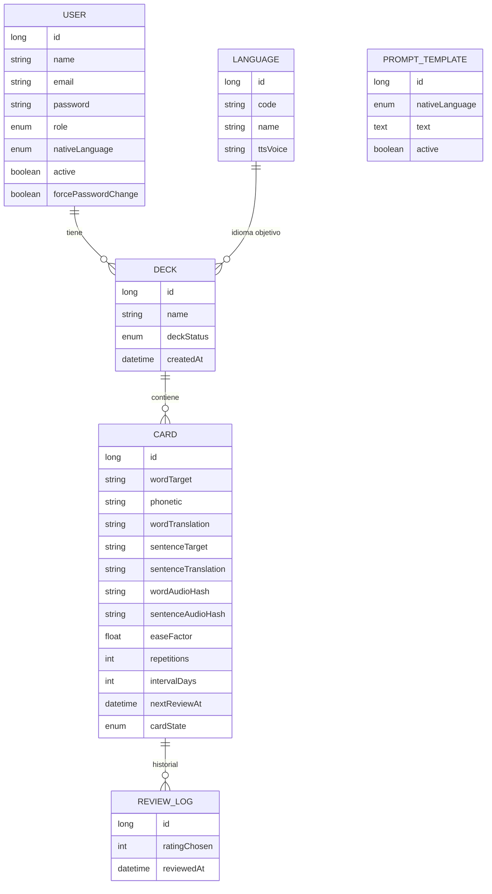
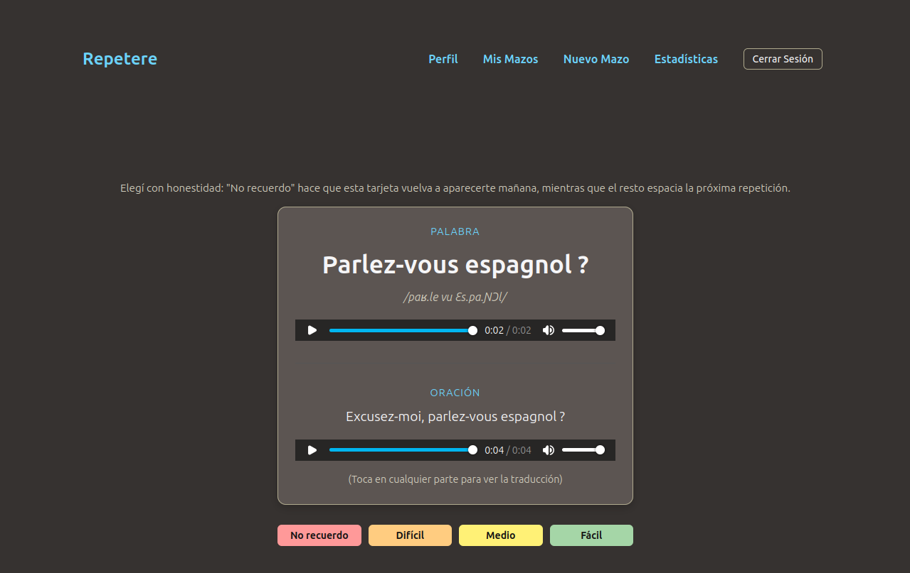
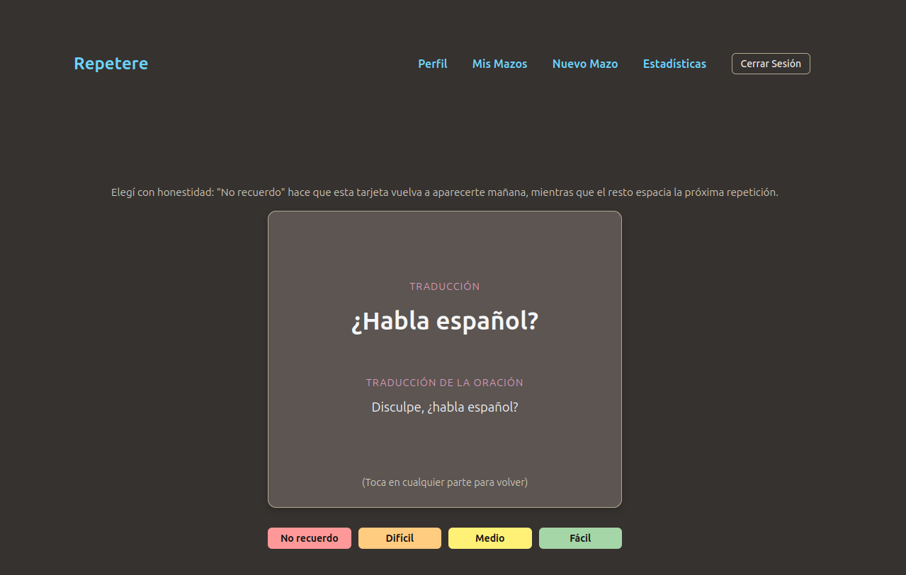
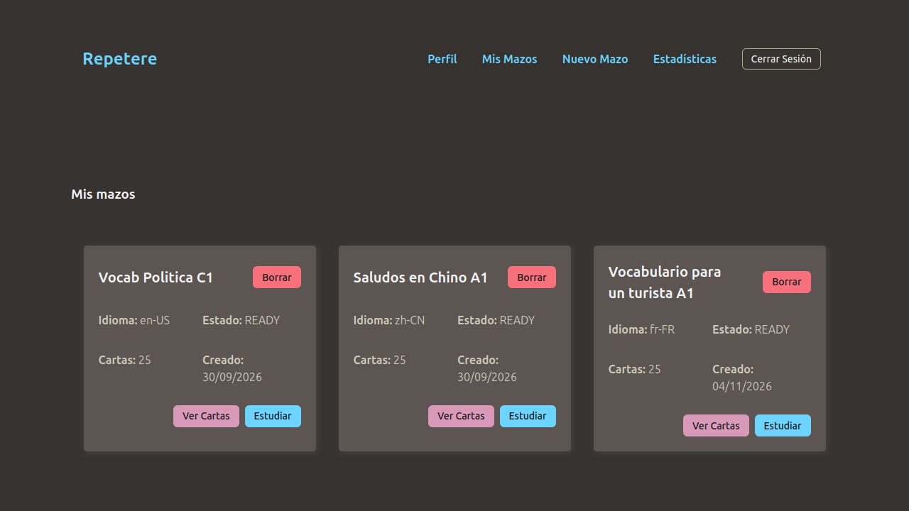
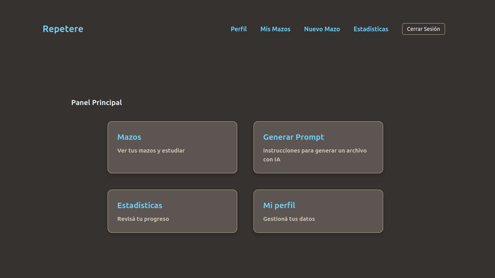
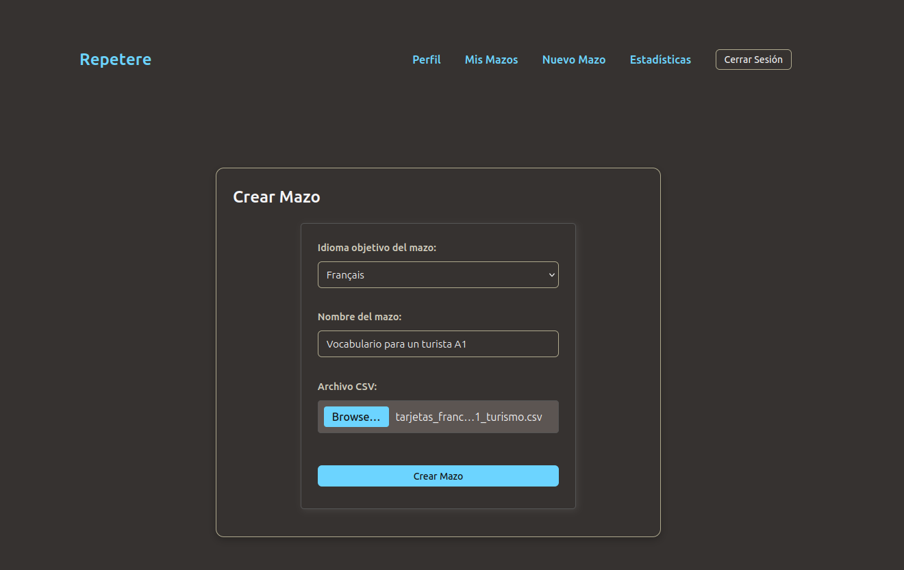
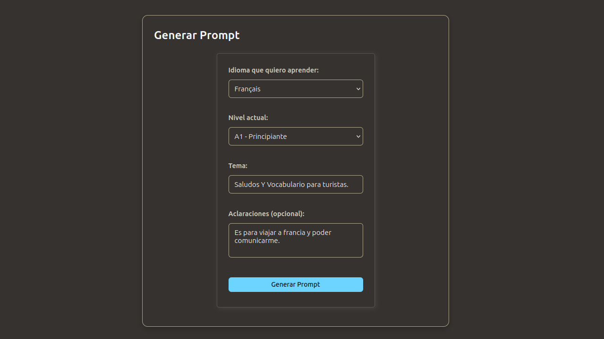

# Repetere

Aplicación web de repetición espaciada para aprender idiomas. La IA genera el vocabulario, el sistema genera los audios y vos estudiás con el algoritmo SM-2.

> Proyecto personal de aprendizaje. Está pensado para correr en local, no para producción por el momento (ver [Limitaciones](#limitaciones-conocidas)).

## Cómo funciona

1. **Generás un prompt.** Elegís el idioma que querés aprender, tu nivel (A1 a C2) y un tema. La app arma el prompt en tu idioma nativo.
2. **Se lo pasás a una IA** (el chat que prefieras) y te devuelve un CSV de hasta 25 tarjetas.
3. **Subís el CSV** y le ponés nombre al mazo.
4. **Se generan los audios** de cada palabra y de cada frase en segundo plano. El mazo aparece como `PROCESSING` y pasa solo a `READY`.
5. **Estudiás.** Cada tarjeta se califica con cuatro botones y SM-2 decide cuándo vuelve a aparecer.

Hay una demo pública, sin login y sin guardar nada, en `/demo`.

## Funcionalidades

- Gestión de usuarios por un administrador (no hay registro público): alta, activar/desactivar, reseteo de contraseña.
- Cambio de contraseña obligatorio en el primer ingreso.
- Perfil: cambio de nombre, email y contraseña.
- Generador de prompts por idioma nativo (español o inglés).
- Importación de mazos desde CSV, con validación.
- Generación de audio con deduplicación: una palabra o frase ya generada se reutiliza.
- Estudio con SM-2, cuatro niveles de calificación y flip de la tarjeta.
- Estadísticas: repasos de hoy, pendientes, tarjetas por estado, racha y retención.
- Límite de mazos por usuario (10 por defecto).

## Stack

| Pieza | Para qué |
|---|---|
| Java 25 + Spring Boot 4.1 | Aplicación principal, seguridad y persistencia |
| Thymeleaf | Vistas renderizadas en el servidor, con fragmentos |
| htmx 2 | Navegación y actualizaciones parciales sin recargar |
| Alpine.js | Interacciones chicas del lado del cliente (flip de la tarjeta, menú) |
| MySQL 8 | Base de datos |
| MinIO | Almacenamiento de los audios (compatible con S3) |
| Python 3.12 + FastAPI | Servicio de síntesis de voz |
| edge-tts | Voces neuronales de Microsoft Edge |
| Docker Compose | MySQL, MinIO, phpMyAdmin y el servicio de TTS |

## Arquitectura



El TTS vive en un servicio aparte porque `edge-tts` es una librería de Python. Java le manda el lote de tarjetas, Python genera y sube los audios y devuelve las keys. En la base se guarda la **key** del objeto, no la URL: las URLs firmadas expiran, así que se generan al momento de mostrar la tarjeta.

## Modelo de datos



`PROMPT_TEMPLATE` no tiene relación con otras tablas: hay una plantilla activa por idioma nativo. El idioma nativo es un enum (`ES`, `EN`) y vive en el usuario. El mazo solo guarda el idioma objetivo.

Estados del mazo: `PROCESSING`, `READY`, `FAILED`. Estados de la tarjeta: `NEW`, `LEARNING`, `REVIEW`.

## Formato del CSV

Cinco campos separados por punto y coma, sin encabezado:

```
palabra;fonética;traducción;frase de ejemplo;traducción de la frase
```

```
hello;/heˈloʊ/;hola;hello my name is Juan;hola mi nombre es Juan
```

- Máximo 25 líneas por archivo.
- Frases de hasta 140 caracteres.
- UTF-8. El parser quita el BOM si el archivo lo trae (algunas IAs lo agregan).
- Si una línea no tiene exactamente cinco campos, se rechaza el archivo completo indicando el número de línea.

## Contrato entre Java y Python

`POST /api/v1/audio/generate`

Request:

```json
{
  "deck_id": 8,
  "minio_lang_folder_path": "en-US",
  "voice": "en-US-AriaNeural",
  "cards": [
    {
      "id": 176,
      "word": "filibuster",
      "word_hash": "<sha256>",
      "sentence": "The senator launched a filibuster.",
      "sentence_hash": "<sha256>"
    }
  ]
}
```

Response:

```json
{
  "cards": [
    {
      "id": 176,
      "word_audio_key": "<key del objeto en MinIO>",
      "sentence_audio_key": "<key del objeto en MinIO>",
      "word_reused": false,
      "sentence_reused": true
    }
  ]
}
```

Java calcula el hash (SHA-256 de `código-de-idioma + "-" + texto en minúsculas`). Python lo usa para nombrar el archivo y, si ya existe en MinIO, lo reutiliza sin volver a sintetizar. Las tarjetas de un lote se procesan en paralelo con un límite de concurrencia: 20 tarjetas tardan unos pocos segundos.

## Algoritmo de estudio (SM-2)

Los cuatro botones se mapean a la escala original de SM-2:

| Botón | Calificación | Efecto |
|---|---|---|
| No recuerdo | 0 | La tarjeta se reinicia y vuelve a aparecer mañana |
| Difícil | 3 | Se espacia, bajando el factor de facilidad |
| Medio | 4 | Se espacia |
| Fácil | 5 | Se espacia más y sube el factor de facilidad |

El factor de facilidad arranca en 2,5 y nunca baja de 1,3. Una tarjeta pasa de `LEARNING` a `REVIEW` cuando su intervalo llega a 5 días. Cada calificación queda registrada en `ReviewLog`.

## Cómo levantarlo en local

**Requisitos:** Docker con Docker Compose, y Java 25.

```bash
git clone <url-del-repo>
cd <repo>

# 1. Servicios de apoyo: MySQL, phpMyAdmin, MinIO y el servicio de TTS
docker compose up -d

# 2. La aplicación
cd repetere
./mvnw spring-boot:run
```

La app queda en <http://localhost:8080>.

| Servicio | URL |
|---|---|
| Aplicación | http://localhost:8080 |
| Demo pública | http://localhost:8080/demo |
| Consola de MinIO | http://localhost:9001 |
| phpMyAdmin | http://localhost:8081 |
| Servicio de TTS | http://localhost:8000 |

Revisá en la consola de MinIO que exista el bucket `repetere-audios`; si no, crealo.

**Usuario inicial:** `[Se crea en el data initizalizer: admin@repetere.com]`

### Configuración

Las propiedades principales están en `repetere/src/main/resources/application.properties`:

| Propiedad | Descripción |
|---|---|
| `spring.datasource.*` | Conexión a MySQL |
| `minio.url`, `minio.access-key`, `minio.secret-key`, `minio.bucket` | Conexión a MinIO |
| `tts.service.base-url` | URL base del servicio de TTS |
| `app.decks.max-per-user` | Máximo de mazos por usuario |
| `spring.servlet.multipart.max-file-size` | Tamaño máximo del CSV |

> Las credenciales del repositorio (`root/root`, `minioadmin/minioadmin`) son valores de desarrollo local. No las uses fuera de tu máquina.

## Estructura del proyecto

```
.
├── docker-compose.yml
├── repetere/                  # Aplicación Java (Spring Boot)
│   └── src/main/
│       ├── java/com/mat/repetere/
│       │   ├── config/        # Seguridad, MinIO, cliente HTTP, datos iniciales
│       │   ├── controller/    # Un controller por acción, agrupados por dominio
│       │   ├── dto/
│       │   ├── exception/     # Excepciones propias y handler global
│       │   ├── interceptor/   # Cambio de contraseña obligatorio
│       │   ├── model/         # Entidades JPA
│       │   ├── repository/
│       │   ├── security/
│       │   └── service/       # Servicios chicos: Creator, Finder, Searcher, Updater, Deleter
│       └── resources/
│           ├── static/        # CSS y audios de la demo
│           └── templates/     # Vistas y fragmentos Thymeleaf
└── tts-service/               # Servicio de voz (FastAPI)
    ├── app/                   # main, schemas, tts, storage, config
    ├── Dockerfile
    └── requirements.txt
```

## Decisiones técnicas

- **Fragmentos de Thymeleaf escritos a mano**, sin librería de layouts. Cada vista tiene un fragmento `content` y un fragmento `page`; el controller devuelve uno u otro según el header `HX-Request`. Así la misma ruta sirve la página completa o solo el pedazo que htmx necesita.
- **`hx-boost` en todo el `body`** para navegar sin recargar, con el token CSRF agregado a cada request de htmx desde un listener.
- **Procesamiento asíncrono con `@Async` y polling**: la creación del mazo responde enseguida y la tarjeta del mazo consulta su estado cada pocos segundos hasta quedar `READY`. El polling se corta solo porque la respuesta final ya no trae el trigger.
- **Deduplicación de audios por hash**, para no sintetizar de nuevo palabras que ya existen.
- **Servicios de una sola responsabilidad** (`DeckCreator`, `DeckFinder`, `DeckSearcher`…), y un controller por acción.
- **SM-2 como función pura**, sin dependencias de Spring ni de la base, fácil de probar con valores sueltos.
- **Excepciones**: un handler global para los errores que terminan en una página de error, y `try/catch` locales donde hay que volver a un formulario con el mensaje.

## Limitaciones conocidas

- **El TTS depende de un endpoint no oficial de Microsoft.** `edge-tts` usa el servicio de lectura en voz alta del navegador Edge, que no es una API pública. En octubre de 2026 dejó de funcionar durante unos días (error 403 en el handshake del WebSocket) y se resolvió actualizando la librería. Por eso la versión está fijada en `requirements.txt` (`edge-tts==7.3.1`). Si falla, los mazos nuevos quedan en `FAILED`; los que ya tienen audio siguen funcionando.
- **Un solo audio que falle hace fallar el lote completo.**
- **El CSV no se guarda.** Si borrás un mazo y querés recrearlo, necesitás el archivo de nuevo (los audios sí se reutilizan).
- **Pensado para uso local.** Credenciales de desarrollo, puertos publicados y `ddl-auto=update`; sin HTTPS ni migraciones.
- **La aplicación Java todavía no corre dentro de Docker Compose.**
- **La interfaz está solo en español** por ahora.
- **No hay tests automatizados.**

## Estado y próximos pasos

- [x] Usuarios, roles y perfil
- [x] Generador de prompts
- [x] Importación de CSV y generación de audio
- [x] Estudio con SM-2
- [x] Estadísticas
- [x] Demo pública
- [ ] Interfaz en inglés (según el idioma nativo del usuario)
- [ ] Dockerizar la aplicación Java
- [ ] Tests (empezando por SM-2 y el parser de CSV)
- [ ] Migraciones de base de datos
- [ ] Contraseñas iniciales aleatorias

## Capturas de pantalla








